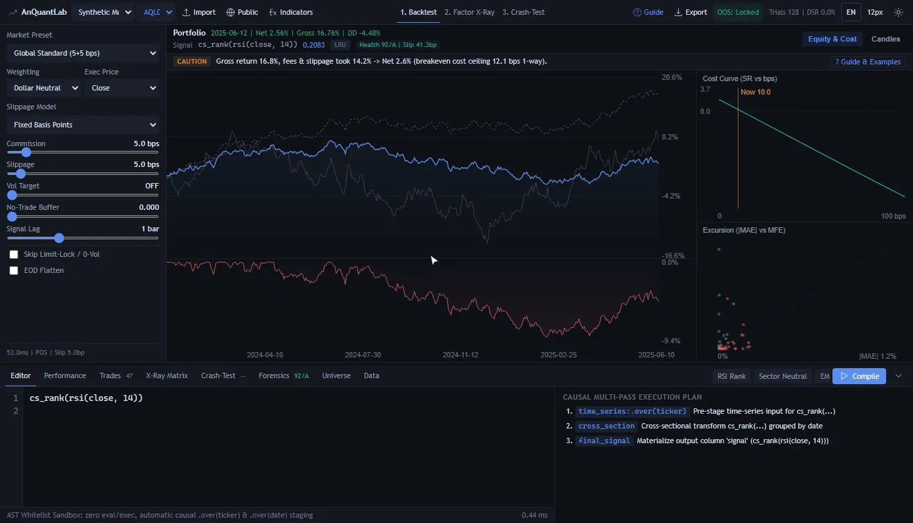

# AnQuantLab

Interactive Quantitative Alpha & Small-Sample Falsification Terminal powered by [polars-anta](https://pypi.org/project/polars-anta/) (`>= 0.4.0`) and [Polars](https://pola.rs/).

`anquantlab` turns small-sample and free OHLCV data constraints into rigorous econometric guardrails: endogenous zero-orderbook spread estimation, automated dirty-bar and survivorship forensics, a sealed 75/25 Out-of-Sample Holdout Vault, an eigenvalue-adjusted cumulative Session Trial Ledger, 5-Factor Zoo Spanning checks, Romano-Wolf stepdown falsification, and 1-Click standalone `Polars + polars-anta` code generation.

**Live Web App:** [http://103.57.223.106:8506/](http://103.57.223.106:8506/)

## Interactive Demo Walkthrough



*End-to-end English workbench walkthrough: Interactive Guide & Real Data import notes (Binance / Stooq) -> Case 1 backtest -> No-Trade Buffer sensitivity -> 4-stage Factor X-Ray & 5-Factor Spanning -> Crash-Test suite (2D Sharpe Surface, CSCV PBO, Bootstrap, Romano-Wolf, CUSUM) -> Standalone `Polars + polars-anta` code export.*

## Key Capabilities

1. **Dynamic 223-Function Catalog & Safe Causal AST DSL**:
   - Runtime introspection of all 225 public `polars-anta` exports (`Ctrl+K` Indicator & Primitive palette).
   - Zero-`eval` AST whitelist compiler that automatically stages time-series `.over(symbol)` and cross-sectional `.over(timestamp)` passes with strict zero look-ahead causality.
2. **Free-Data Forensics, Implicit OHLCV Spreads & Zero-Key Data Hub**:
   - Sub-15ms dataset health scoring (`0-100`) detecting OHLC boundary violations, unadjusted split/dividend jumps, zero-volume/frozen bars, and early-dropout survivorship risk.
   - Zero-orderbook microstructure estimators (`corwin_schultz_spread`, `roll_spread`, `amihud_illiquidity`) directly from free OHLCV bars.
   - Optional zero-API-key legal public connectors (`Binance Public Klines` with `taker_buy_ratio` orderflow and `Stooq US Sector ETFs`), cached outside the Git repository tree.
3. **Tab 1 - Backtest, Endogenous Cost Lab, Holdout Vault & Trial Ledger**:
   - Two-tier cached portfolio simulation (`< 30ms` warm slider latency) across `dollar_neutral`, `long_only`, `equal_weight`, and `raw` schemes with limit-lock skip and intraday session flatten rules.
   - Sealed `75% IS / 25% OOS` Holdout Vault and live Session Trial Ledger tracking distinct trials, eigenvalue effective independent signals (`N_eff`), OOS peeks, and live Deflated Sharpe Ratio (`DSR`).
4. **Tab 2 - 4-Stage Causal Alpha Pipeline X-Ray & 5-Factor Spanning**:
   - Step-by-step inspection across `Raw -> cs_winsorize -> neutralize -> orthogonalize` with quantile spreads, IC decay half-life, and sector net exposure verification.
   - Driscoll-Kraay HAC spanning regression against a canonical 5-Factor Zoo (*Momentum, Short-Term Reversal, Yang-Zhang Volatility, Amihud Illiquidity, Market Beta*) separating spanned `R^2` from pure orthogonal alpha.
5. **Tab 3 - Overfitting Crash-Test & Small-Sample Stress Suite**:
   - Automatic 2D AST parameter perturbation heatmaps with Moore-neighborhood plateau ratios, CSCV Probability of Backtest Overfitting (`pbo_cscv`), and 4-bar Multiple-Testing Sharpe Haircuts (`Observed -> Grid DSR -> Session Ledger DSR -> Empirical-Bayes Posterior`).
   - `200` Stationary Block Bootstrap synthetic worlds paired with `200` Block-Rademacher Null Permuted worlds, a 7-stage Romano-Wolf FWER stepdown funnel, Ploberger-Kramer OLS-CUSUM structural break detection, and a Survivorship Delisting Penalty drag slider.
6. **1-Click Production Codegen, Bilingual HTML Tearsheet & Alpha Passport**:
   - Transpiles validated UI formulas and friction rules into standalone, AST-sandbox-verified `Polars + polars-anta` `.py` scripts (`0` `anquantlab` runtime lock-in), offline bilingual (`EN` / `VI`) single-file HTML tearsheets, and SHA-256 signed `alpha_passport.json` audit manifests.
7. **Bilingual EN / VI Interface, Guided Case Studies & Responsive Layout**:
   - Auto-detects browser language on first visit (`EN` / `VI` switcher in the top toolbar) across desktop, tablet, and mobile viewports.
   - Includes a built-in `? Guide` modal with one-click demo case studies (`Overview & Examples`) and direct CSV import instructions for `Binance` and `Stooq`.

## Live Web App & Local Quick Start

### Option A - Hosted Online Demo (Recommended)

Open [http://103.57.223.106:8506/](http://103.57.223.106:8506/) directly in any modern browser. No local Python environment, Node.js, bundler, or CDN access is required.

### Option B - Run Locally on Your Machine

`127.0.0.1:8765` is a local loopback address that is reachable only after starting the server on your own machine:

```bash
git clone https://github.com/huuan26/anquantlab.git
cd anquantlab
pip install -e .
anquantlab serve --port 8765
```

When running locally on `127.0.0.1` (default host and port `8765`), AnQuantLab opens your browser automatically unless `--no-browser` is specified. Use `--host` and `--port` (or `ANQUANTLAB_HOST` / `ANQUANTLAB_PORT`) to customize the bind address.

## Resource & Server Safety Configuration

All operational limits are configured via `ANQUANTLAB_*` environment variables for safe co-location on shared Linux research or HFT servers (see `deploy/anquantlab.service.example`):

| Variable | Default | Description |
| :--- | :--- | :--- |
| `ANQUANTLAB_HOST` | `127.0.0.1` | Bind address (keep `127.0.0.1` behind SSH tunnel or reverse proxy) |
| `ANQUANTLAB_PORT` | `8765` | HTTP listen port |
| `ANQUANTLAB_MAX_THREADS` | `2` | Pins `POLARS_MAX_THREADS` before Polars initializes |
| `ANQUANTLAB_MAX_CONCURRENT` | `2` | Async semaphore cap on concurrent compute requests |
| `ANQUANTLAB_COMPUTE_TIMEOUT_SEC` | `15.0` | Per-request execution timeout guard |
| `ANQUANTLAB_MAX_UPLOAD_MB` | `50` | Maximum `.parquet` / `.csv` upload payload |
| `ANQUANTLAB_ALLOW_PUBLIC_FETCH` | `1` | Set `0` for strict air-gapped / offline operation |
| `ANQUANTLAB_CACHE_DIR` | `~/.anquantlab/public_cache` | External cache directory outside Git |
| `ANQUANTLAB_READONLY_PATHS` | unset | Optional semicolon/colon-separated read-only `.parquet`/`.csv` paths |

## Development & Verification

```bash
ruff check .
ruff format --check .
pytest tests -v
```

## License

Apache-2.0
